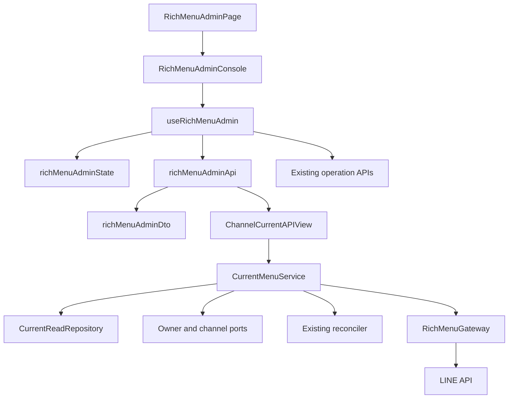
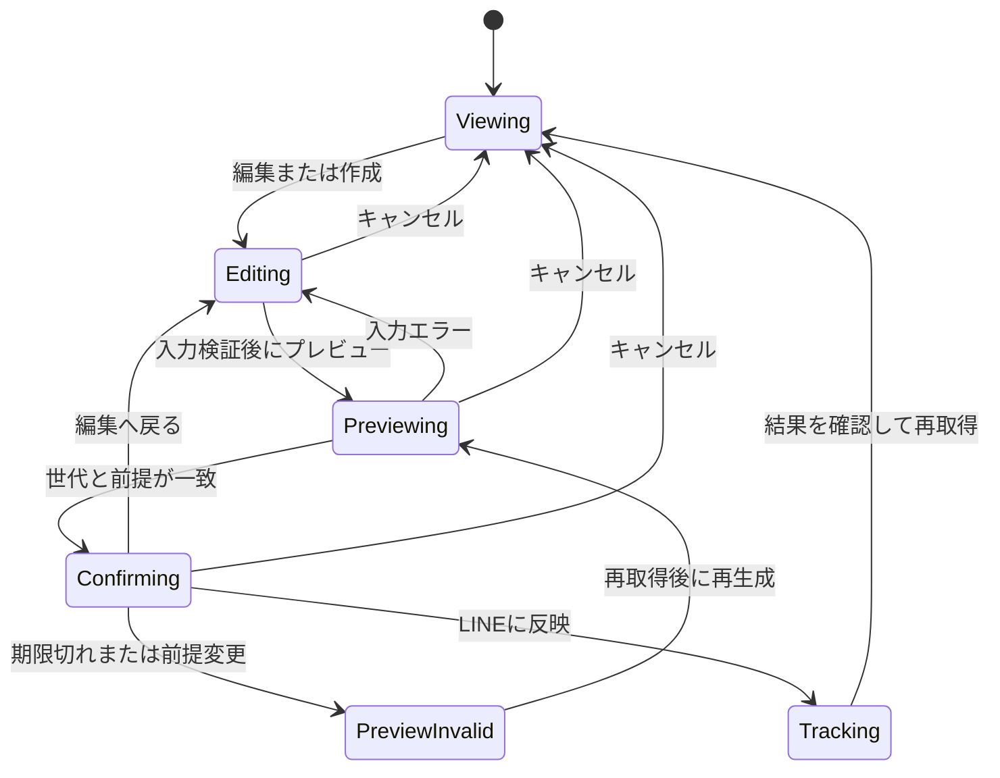

# 技術設計: line-rich-menu-detail-ui

## Overview

認証済みownerが `/liff/rich-menus/{channelId}` で現在の管理対象画像を確認し、明示的に編集・確認・適用へ進む詳細画面を提供する。閲覧画像と保存済み設定を、LINEの実状態とローカルの認可・資源・操作状態を検証した一つの読み取り結果として返す。

既存の適用・解除・回復・チャネルライフサイクルを再利用し、画面から履歴一覧取得と常設状態一覧を外す。旧specとの優先関係はrequirements.md「既存仕様との優先関係」に従う。既存specの本文・承認・完了タスクは変更しない。

### Goals / Non-Goals

- 現在画像、未適用の入力、期限付きプレビューを区別する。
- 画像だけの取得失敗でも、確認済みの状態と許可操作を利用できるようにする。
- 履歴APIなしで操作追跡・回復・チャネル削除確認を継続する。
- 外部資源の内容取得、新規テンプレート、画像生成デザイン変更、画像保存、下書き永続化、認証・共通ヘッダー再設計は行わない。

## Boundary Commitments

### This Spec Owns

- **B1 閲覧**: 現在資源と作成元設定の検証、表示用画像取得、取得前後のfence、閲覧APIと安全な失敗分類。既存mutationの受付条件を参照した、current専用の操作候補projection。
- **B2 画面**: DTO・通信・純粋状態遷移・画像寿命、閲覧／編集／確認の表示、履歴一覧撤去、既存操作への接続。管理終了の確認文言と表示条件はB1の操作候補projectionに従う。
- **B3 統合**: 既存データ互換性、認可・競合・回復の回帰、操作後更新、狭幅・配色・キーボードの検証。

### Out of Boundary

- プレビューの正規化・画像生成・10分期限・確認値、LINE資源の所有権、適用・解除・管理終了・再確認・後片付けの業務状態機械。
- チャネル停止・再有効化・削除の業務判定、履歴記録・参照API・purge。
- アプリ外メニューの内容取得・編集・削除、過去画像、ロールバック、利用者別メニュー、別の履歴画面。

### Allowed Dependencies

- `linerichmenus` のcatalog、reconciliation、repository、gateway、readinessと既存mutation service。閲覧serviceはmutationを呼ばない。
- `lineaccounts.admin_authorization` のowner fence、`linechannels.admin_types` と `admin_lifecycle_types` の公開値型。channel／deactivation repositoryは `container.py` からtyped portへ注入し、閲覧serviceから他appのModel・非公開repositoryをimportしない。
- Frontendの `httpApi.ts`、既存DTO、チャネルAPI、route page、PageFrameとtheme token。API／DTO／StateからRouterを参照しない。

### Revalidation Triggers

- current resourceとorigin operationの関係、snapshot形式、template版とarea順序が変わる場合は既存データfixtureと編集初期化を再検証する。
- owner／channel／operation／deactivationのlock順序やrevision更新規則が変わる場合は閲覧競合テストを再実行する。
- 実状態分類、effectiveActions、回復対象関係、mutation modeの変更は閲覧APIと回復UIを再検証する。
- 画像形式・上限、SDK download戻り値、認証失効通知、route寿命が変わる場合は画像検証と破棄契約を再検証する。

## Architecture

### Existing Architecture Analysis

現行Consoleはチャネル・テンプレート・state・history・deactivationを一括取得し、editorと状態一覧を常設する。pageもチャネルを取得する。`RichMenuChannelState.current_resource → ManagedRichMenu.origin_operation → RichMenuOperation.configuration_snapshot` は初期migrationから存在する。画像gatewayの `download` は画像の寸法・digest等だけを返し、bytesを公開しない。

新しい閲覧ユースケースを `current_service.py` に分離し、既存の大きなmutation serviceへ追加しない。`GET current/` は既存stateを内包する別endpointとし、厳格な既存DTOを破壊しない。画像と設定の結果を一つのJSONへまとめ、画像失敗は判別可能な部分結果として返す。初期表示で現在領域は取得中になり、結果到着後に状態・画像または画像失敗を同時に確定する。



依存方向はBackendが値型／公開port → repository・gateway → service → container・HTTP境界、FrontendがDTO → API・State → hook →表示Component → Pageとする。右側は左側へ依存し、逆向きimportは許可しない。containerだけが具象adapterを組み立てる。上図の矢印は呼び出し方向を示す。

### Technology Stack

| Layer | Choice / Version | Role / Notes |
| --- | --- | --- |
| Frontend | React 19.2.7、TypeScript 6.0.3、React Router 8.3.1 | 既存構成、純粋reducerとhook。新規依存なし |
| Styling | Tailwind CSS 4.3.3 | 既存theme token、通常のdetailsとbutton |
| Backend | Python 3.14、Django 6.0.7、DRF 3.17.1 | 短いtransactionとowner付きGET |
| LINE／画像 | line-bot-sdk 3.25.0、HTTPX 0.28.1、Pillow 12.3.0 | 既存gatewayを拡張、画像再生成なし |
| Storage | MySQL 8.4、既存3モデルの関連 | schema変更・backfill・新規画像保存なし |

## File Structure Plan

各行をTasksの `_Boundary:_` から参照する。B1とB2はHTTP契約確定後に独立実装できる。B3は双方を統合する。

| 境界 | Path / 変更 | 単一の責務 |
| --- | --- | --- |
| B1 | `backend/linerichmenus/current_types.py` 新規 | immutableな閲覧snapshot・結果・portの型 |
| B1 | `backend/linerichmenus/types.py` 変更 | 閲覧限定の安全な競合code `CURRENT_CHANGED` の追加 |
| B1 | `backend/linerichmenus/current_service.py` 新規 | CurrentMenuServiceの認可・観測・最終検証と操作候補の合成 |
| B1 | `backend/linerichmenus/repository.py` 変更 | CurrentReadRepositoryのsnapshot取得、対応関係、fence比較、管理終了対象の検証、回復対象projection |
| B1 | `backend/linerichmenus/gateway.py` 変更 | 検証済み画像bytesを返すdownload_contentと既存観測互換 |
| B1 | `backend/linerichmenus/presenters.py` 変更 | 閲覧結果のallowlist JSON化 |
| B1 | `backend/linerichmenus/serializers.py` 変更 | 閲覧queryのchannelRevision検証 |
| B1 | `backend/linerichmenus/views.py` 変更 | ChannelCurrentAPIViewとno-storeのHTTP境界 |
| B1 | `backend/linerichmenus/urls.py` 変更 | current endpoint登録 |
| B1 | `backend/linerichmenus/container.py` 変更 | current serviceと既存公開portの合成 |
| B2 | `frontend/src/richMenuAdminDto.ts` 変更 | CurrentMenuViewの厳格な境界検証 |
| B2 | `frontend/src/richMenuAdminApi.ts` 変更 | getCurrent、既存認可失効通知、安全なエラー分類 |
| B2 | `frontend/src/richMenuAdminState.ts` 変更 | 閲覧・編集・確認・操作結果の純粋状態遷移、historyの除去 |
| B2 | `frontend/src/useRichMenuAdmin.ts` 新規 | Consoleから通信接続を抽出、世代・latch・read中止・Object URL・タイマーを所有 |
| B2 | `frontend/src/RichMenuAdminConsole.tsx` 変更 | 表示構成とイベント接続、停止・削除の折りたたみ |
| B2 | `frontend/src/RichMenuCurrentMenu.tsx` 新規 | 現在画像、loading、画像失敗、未設定、停止中の表示 |
| B2 | `frontend/src/RichMenuEditor.tsx` 変更 | 明示的な初期draft、版一致、入力とキャンセル |
| B2 | `frontend/src/RichMenuPreview.tsx` 変更 | 未適用確認と全項目・期限・影響の常時表示 |
| B2 | `frontend/src/RichMenuOperationPanel.tsx` 変更 | 確認済み適用の接続と短い直前結果 |
| B2 | `frontend/src/RichMenuRecoveryPanel.tsx` 変更 | 必要時だけの回復・解除確認、許可された対象の選択 |
| B2 | `frontend/src/RichMenuStatePanel.tsx` 変更 | 常設一覧から短い状態・禁止理由へ整理、既存labelの共用 |
| B2 | `frontend/src/RichMenuAdminPage.tsx` 変更 | initial channelを渡して二重初期取得を除去、route寿命を維持 |
| B2 | `frontend/src/style.css` 変更 | 現在画像と入力・確認のlayout、tokenに沿う狭幅表示 |
| B3 | `backend/linerichmenus/tests/test_current_repository.py` 新規 | 対応関係・管理終了対象の適格性・旧snapshot・query数 |
| B3 | `backend/linerichmenus/tests/test_current_service.py` 新規 | owner・revision・資源・操作・停止の競合、管理終了候補と既存mutationの接続 |
| B3 | `backend/linerichmenus/tests/test_current_api.py` 新規 | status/body/no-store・秘密非露出・部分失敗、mode別の管理終了候補 |
| B3 | `backend/linerichmenus/tests/test_gateway.py` 変更 | 画像bytes検証と既存download互換 |
| B3 | `backend/linerichmenus/tests/test_performance.py` 変更 | 閲覧の外部呼出数と一連のquery budget |
| B3 | `frontend/test/richMenuAdminDto.test.ts`、`frontend/test/richMenuAdminApi.test.ts` 変更 | 新境界・認可失効・異常DTO |
| B3 | `frontend/test/richMenuAdminState.test.ts` 変更、`frontend/test/useRichMenuAdmin.test.tsx` 新規 | 状態遷移・後着結果・画像寿命 |
| B3 | `frontend/test/RichMenuCurrentMenu.test.tsx` 新規 | 状態別の画像・補助操作・代替テキスト |
| B3 | `frontend/test/RichMenuAdminConsole.test.tsx`、`frontend/test/RichMenuEditor.test.tsx`、`frontend/test/RichMenuPreview.test.tsx` 変更 | 閲覧から編集・確認・キャンセル |
| B3 | `frontend/test/RichMenuOperationPanel.test.tsx`、`frontend/test/RichMenuRecoveryPanel.test.tsx` 変更 | 結果と現在表示の分離、対象限定の回復、管理終了の確認と対象接続 |
| B3 | `frontend/test/RichMenuAdminPage.test.tsx`、`frontend/test/AppScreenSeparationIntegration.test.tsx` 変更 | 離脱・再訪・既存ライフサイクル |
| 文書 | `CONTEXT.md`、`.kiro/steering/product.md`、`.kiro/steering/line-integration.md` | 承認済みの用語・現在画像・履歴非表示方針の同期 |

`RichMenuHistory.tsx` と `frontend/test/RichMenuHistory.test.tsx`、既存 `getHistory`・history DTO・履歴APIは保持し、Consoleから参照しない。`AuthGate.tsx`、`PageFrame.tsx`、`httpApi.ts`、`channelAdminApi.ts`、Backendのcatalog／renderer／confirmation／reconciliation／mutation services／models、lineaccountsとlinechannelsの公開portは既存依存として利用し、業務仕様を変更しない。

## Components and Interfaces

| Component | Intent | Req Coverage | Key Dependencies | Contracts |
| --- | --- | --- | --- | --- |
| CurrentMenuService | 同一前提の状態・設定・画像・許可操作を構成 | 2.1〜2.7、3.1〜3.7、6.7、7.3〜7.4 | owner/channel port P0、repository P0、gateway P0 | Service / State |
| CurrentReadRepository | 保存関係と競合snapshot | 2.3〜2.5、3.5、6.6〜6.7 | 自app models P0、公開scope P0 | Service |
| RichMenuGateway | 元の画像bytesを検証して返す | 2.2、2.6〜2.7、3.1 | LINE SDK P0、HTTPX P0、Pillow P0 | Service |
| ChannelCurrentAPIView | 認証済み閲覧HTTP契約 | 2.1、2.4、2.7、3.7 | current service P0、既存OwnerProtectedAPIView P0 | API |
| richMenuAdminDto / Api | unknownの検証と単発通信 | 2.7、3.2、3.7、8.3 | httpApi P0 | API |
| richMenuAdminState / useRichMenuAdmin | 表示状態と副作用の分離 | 4、5、6、7、8 | 既存mutation API P0 | State / Service |
| RichMenuAdminConsole / CurrentMenu / StatePanel | 閲覧表示と必要な案内 | 1、3、7、9 | hook P0、theme P1 | State |
| Editor / Preview / OperationPanel / RecoveryPanel | 編集・確認・既存操作の接続 | 4、5、6、9 | reducer P0、既存操作契約 P0 | State |

### CurrentMenuService / CurrentReadRepository

**Requirements**: 2.1, 2.2, 2.3, 2.4, 2.5, 2.6, 2.7, 3.1, 3.2, 3.3, 3.4, 3.5, 3.6, 3.7, 6.6, 6.7, 7.3, 7.4。

**Contracts**: Service / State。InboundはHTTP View、Outboundは注入されたowner fence・channel port・deactivation read port・repository・reconciler・gateway・catalog・readiness（すべてP0）。値型とrepository portは `current_types.py`、service署名は `current_service.py` に置く。エラーは既存 `ServiceFailed` のsafe codeへ収束する。`current_types.py` から既存servicesやrepositoryを実行時importせず、循環依存を作らない。

```python
class CurrentMenuService(Protocol):
    def get_current(
        self, owner: OwnerOperationContext, channel_id: UUID,
        expected_channel_revision: datetime,
    ) -> CurrentMenuSucceeded | ServiceFailed: ...

class CurrentReadRepository(Protocol):
    def capture_current(self, scope: OwnerChannelScope) -> CurrentReadSnapshot: ...
    def lock_current_unchanged(
        self, scope: OwnerChannelScope, expected: CurrentReadSnapshot,
    ) -> CurrentReadMatched | CurrentReadConflict: ...
```

#### 取得とfence

1. 最初の短いtransaction内でownerのactive sessionとproviderを再検証する。公開channel metadataのproviderが完全一致し、要求revisionが一致することを確認してchannelをlockする。active時だけ `snapshot_exact` で資格情報を取得する。停止中は資格情報を復号せず、同一transactionで保存済みprojectionを返す。
2. channel lock後にdeactivation intent、rich-menu channel state、current resourceとorigin operation、active/blocking operation、回復候補を読む。既存mutationと同じ **owner → channel → deactivation → rich-menu state → operation/resource** の順序を守る。最終段でlockする行も同じ順序にする。
3. transactionを閉じて既存reconcilerへsnapshot上の管理対象を渡し、既定を照会する。管理対象との一致が確認でき、処理中・結果不明・外部変更のない場合だけ当該IDの画像を取得する。cleanup_requiredでも、新資源の適用が確定し現在既定と一致する場合は閲覧画像を返せる。未知の外部IDに画像／内容GETを行わない。
4. 画像取得の成否にかかわらず、取得を試みた場合は既定をもう一度照会する。最初と同じ管理資源であることが確認できなければ画像・設定を破棄し `409 current_changed` を返す。再照会自体が失敗した場合も画像だけの失敗へ縮約しない。
5. 最終transactionでowner、provider、channelのactive/revision、deactivation intentのID・status・updatedAt、rich-menu stateのcurrent/active/blocking参照、関連operationのstatus/stage/updatedAt、resourceのlifecycle/LINE ID/digest/updatedAt、origin operationとsnapshot内容、cleanup関係を比較する。行の消滅・新規作成も差分に含む。変更があれば結果を破棄する。
6. 一致時だけ観測を記録してsafe DTOを構成する。観測日時だけが変わる別readでは不要な競合を起こさず、資源・操作・設定の比較を省略しない。観測記録は既存の状態記録であり、閲覧操作履歴や画像を保存しない。

停止中はmetadataと保存済み状態を同じlock内で読む。channel portの `lock_connection_revision` とmetadataの厳密provider照合を使い、activeを要求する `lock_unchanged` を停止中へ流用しない。deactivation情報は既存 `get_for_owner` の公開値型をcontainerで注入して取得し、app外のModelを直接読む実装は禁止する。

DBとLINEをまたぐ原子的snapshotは保証できない。最終LINE観測・DB検証時点で確認できた結果として扱い、以後の外部変更は更新または既存mutationの再検証で検出する。画面が開いているだけの自動pollingは追加しない。

#### 対応設定の検証

- current resourceが同じchannelに属し、origin operationが同じowner・provider・channelの `apply` であることを検証する。成功または適用が確定した後片付け待ちだけを有効とする。履歴の先頭・類似値から補完しない。
- snapshotは辞書、非空template ID、正の整数版、順序付きfields配列、各項目の文字列・完全HTTPS URIを検証する。username/password付きURI、欠損、不正型は採用しない。値はトリム・短縮・別値への正規化をせず返す。
- 同一template ID・版のdescriptorがあれば、fields数・area順序・既存入力規則の一致を検証し `editability: editable` とする。配列からeditorのfield名への対応はその版のdescriptorのarea順だけを使う。
- descriptorが廃止済みでも構造が正常なsnapshotは閲覧用として返し、`editability: template_unavailable` とする。欠落・不正snapshotは `configuration: unavailable`。いずれも別版の自動選択を禁止し、許可状態の下で明示的な作り直しへ進む。
- 同一版の全項目を正しく初期化できない場合も `configuration_invalid` とする。既存適用済みデータの関連をそのまま使い、再適用やmigrationを要求しない。

#### 操作可否と回復対象

`effectiveActions` はCurrentMenuServiceがBackendで合成する。reconciliationは観測分類の入力とし、その操作候補をそのまま画面へ転送しない。現行reconcilerは `managed_default` の場合だけ `release` を返すため、外部変更時の管理終了は、保存済み対象と既存mutationの受付条件を確認したcurrent専用projectionで補う。既存state endpoint、reconciler、mutationの受付・実行契約は変更しない。

CurrentReadRepositoryは、同一channelのstate.current_resourceが同一owner・providerの作成元applyに結び付き、lifecycleが `applied` であることを確認し、request内snapshotへ管理終了対象の適格性を保持する。これは `_start_release` とrepositoryの `accept` が要求する現在資源・対象・scopeの条件を参照する。設定snapshotの欠損・廃止版と資源の所有権は別に検証し、設定を編集できなくても所有関係が有効なら管理終了対象にできる。画像や設定の成功を管理終了の前提にしない。取得後のfenceでも対象と関係を再検証する。

操作候補は次の順序で決める。

1. inactiveは読取専用、deactivation pendingはそのintentに許可された回復だけとし、新規preview/apply/unlink/releaseを候補へ入れない。
2. active operation、blocking operation、未解決cleanupがある場合はrepositoryの既存制限を優先する。通常操作や管理終了を追加せず、recheck/cleanupは有効なsubject・対象関係がある場合だけ候補に残す。
3. 上記制限がなく、観測と保存関係が有効な場合だけ次表を適用する。管理終了対象が不適格な場合は `release` を返さず、対応関係の要確認案内を残す。未知の観測を既知の外部変更として扱わない。
4. 候補を既存readinessへ渡し、`read_only` は変更不可、`recovery_only` は既存の回復操作だけ、`enabled` は候補内の操作だけを `effectiveActions` とする。readinessは欠けた候補を追加しない。`rich.nextAllowedActions` は同じ合成済み候補、`rich.effectiveActions` はmode適用後の候補を返す。

| 観測と保存済みcurrent | current.kind | 制限・mode適用前の変更操作候補 | 管理終了の導線 |
| --- | --- | --- | --- |
| managed_default、適格なcurrentと一致 | managed | new_preview、apply、unlink、release | 主操作は編集。管理終了は補助の折りたたみから明示確認 |
| default_none、保存済みcurrentなし | unset | new_preview、apply | 対象がないため提供しない |
| external_default、保存済みcurrentなし | external | new_preview、apply | 外部資源は対象にしない |
| default_none／external_default／other_managed_default、適格なcurrentあり、現在既定と不一致 | attention | 既存reconciliationのnew_preview、applyにreleaseを追加 | 外部変更の案内に、以前の管理対象の追跡を終える操作を表示 |
| unknownまたは解釈不能な観測・不正な対象関係 | attentionまたは全体取得失敗 | 通常変更・releaseなし | 再取得案内。有効なblocking operationがある場合の回復は上記2に従う |

表の変更操作とは別に `get_state`・既存参照用の `view_history` は保持できるが、詳細画面は履歴を取得・表示しない。画像だけの欠損・decode失敗で操作可否を変えない。設定を編集できるかは別の `editability` で表す。

Frontendは `rich.effectiveActions` に `release` がある場合だけ管理終了を表示し、対象には `rich.currentResource.resourceId` を使う。`current.kind: attention` は表示画像・設定を持たないが、既存rich schemaの現在管理資源参照は保持する。外部既定ID、cleanup候補、履歴の資源を管理終了対象へ代用しない。実行時は既存 `startOperation(kind: release, targetResourceId, channelRevision, operationId)` に接続し、再認可・revision・現在参照・操作競合・停止intentの検証は既存mutationに委ねる。projectionは実行許可を予約せず、表示後の競合は拒否と再取得へ収束させる。

`recoveryTargets` は現行blockerに対して既存の所有権・subject・target・replacement関係を満たす組だけを返す。置換後のcleanupでは `resource.replacement_operation_id == subject.operation_id`、失敗した候補の回復では既存accept_recoveryのorigin/target規則を使う。回復の許可判定を新設せず、既存repository判定と同じprivate predicateを共用する。関係不明の旧資源を候補へ混ぜない。実行時の再検証は既存mutationが引き続き行う。

### RichMenuGateway

**Requirements**: 2.2, 2.6, 2.7, 3.1。**Contract**: Service。

`download_content(context, rich_menu_id) -> DownloadedImage | ImageAbsent | ImageObservationUnknown | GatewayRejected` を追加する。`DownloadedImage` は `ImageObserved` のmetadataと元のbytesを保持する非シリアライズ・repr非露出のimmutable値。既存 `download` の戻り値とSDK経路は変更せず、画像decodeの検証を共用する。呼び出しごとのLINE downloadは一回だけ。

LINEの `api-data.line.me` の画像GETを既存依存HTTPXのstreamで使う。固定hostと検証済みrichMenuIdだけでpathを構成し、redirectを追従しない。Bearer credentialはgateway内だけで設定する。既存SDK 3.25.0は非preload指定でもApiResponse生成でbodyを全量取得するため、表示用download_contentには用いない。PNG/JPEGの実decode、最大1 MiB、幅800〜2500、高さ250以上、幅/高さ1.45以上を確認する。寸法はpixel展開前に検証し、全フレーム展開やSVG・HTMLを許可しない。読み込みは上限+1 byteで打ち切る形にし、HTTPX response/clientを必ずcloseする。実bytesから得た形式を用い、上流のContent-Typeだけを信用しない。

取得画像のcanonical pixel digestと管理資源のdigestが一致しない場合は `current_changed` として全体再取得へ戻す。bytesは再エンコードせず返す。404は `missing`、timeout/429/5xxは安全な画像失敗理由へ変換する。owner認可の失敗とは別境界で扱う。

### ChannelCurrentAPIView: API Contract

| Method | Endpoint | Request | Response | Errors |
| --- | --- | --- | --- | --- |
| GET | `/api/line/rich-menus/channels/{channelId}/current/?channelRevision={ISO8601}` | UUID path、timezone-aware revision必須、owner session | `CurrentMenuView` | 400 / 401 / 403 / 404 / 409 / 503 |

成功・失敗とも `Cache-Control: no-store`。owner sessionとsame-providerの検証はreadでも必須。現在画像はJSON内のBase64に限定し、public URL・追加画像token・画像用キャッシュを導入しない。生成プレビューのconfirmationTokenやexpiresAtを返さない。

```typescript
type CurrentImage =
  | { status: 'available'; contentType: 'image/png' | 'image/jpeg';
      width: number; height: number; digest: string; base64: string }
  | { status: 'unavailable'; reason: 'missing' | 'invalid' | 'fetch_failed' | 'rate_limited' }

type CurrentConfiguration =
  | { status: 'available'; templateId: string; templateVersion: number;
      fields: TemplateField[]; editability: 'editable' | 'template_unavailable' }
  | { status: 'unavailable'; reason: 'mapping_missing' | 'configuration_invalid' }

type CurrentContent =
  | { kind: 'managed'; resourceId: string; image: CurrentImage;
      configuration: CurrentConfiguration }
  | { kind: 'unset' | 'external' | 'attention' | 'inactive' }

type RecoveryTarget = {
  kind: 'cleanup'; subjectOperationId: string; targetResourceId: string
}

type CurrentMenuView = {
  channelId: string
  channelRevision: string
  checkedAt: string | null
  rich: RichMenuStateView
  deactivation: DeactivationView | null
  current: CurrentContent
  recoveryTargets: RecoveryTarget[]
}
```

`rich` と `deactivation` は既存公開schemaを再利用する。deactivationのJSON化は既存 `AdminPresenter.deactivation` に委譲する。`checkedAt` は今回の外部観測時刻で、停止中はnull。channelRevisionから観測時刻を生成しない。

| current.kind | 成立条件 | 表示・取得 |
| --- | --- | --- |
| managed | active、現在資源と現在既定が一致、結果不明・進行中なし | 当該画像と設定。確定済みcleanup待ちは追加案内 |
| unset | default_none、保存済みcurrentなし、未解決操作・資源なし | 未設定。new_preview許可時だけ作成 |
| external | 既定がアプリ外、追跡中currentの外部変更ではない | LINE側の確認案内。内容取得・編集・削除なし |
| attention | 外部変更、other_managed_default、観測unknown、処理中、未解決関係 | 理由と許可された更新・回復。画像・設定なし |
| inactive | channel停止中 | 保存済み管理状態・未解決事項。LINE照会なし |

外部メニューの置換が上流契約で許可される場合は「新しいメニューを作成」を提供できるが、外部内容の引継ぎはしない。currentがattentionでも、外部変更解消のために上流が許可する新規プレビューは「作り直す」から空入力で開始できる。結果不明・処理中の新規変更は禁止する。

### richMenuAdminDto / richMenuAdminApi

**Requirements**: 2.7, 3.2, 3.7, 8.3。**Contract**: API。

`getCurrent(channelId, channelRevision, options?: ReadRequestOptions): Promise<CurrentMenuView>` を追加する。既存protected HTTP clientを通して単発GETし、`unknown`からparseする。safe error parserへ `current_changed` を追加する。path対象・revision・rich.channelId・deactivation.channelId/revisionの一致、managed resourceとobservationの一致、回復対象のUUID、tagごとの必須項目を検証する。

Base64構文・decoded size・形式・寸法・digestを検証する。画像フィールドだけが壊れている場合は `image.unavailable: invalid` へ安全に縮退し、正しく検証済みのstate/configurationを保つ。状態・認可・対応関係の不正は全体protocol_errorとする。settingsの不正はconfiguration unavailableへ縮退し、編集を許可しない。unknown statusを成功扱いしない。TemplateFieldのURLは保存値をそのまま保持する。

### richMenuAdminState / useRichMenuAdmin

**Requirements**: 4.1〜4.7、5.1〜5.7、6.1〜6.8、7.1〜7.6、8.1〜8.5。**Contracts**: State / Service。

`useRichMenuAdmin` は既存Consoleの通信とlatchを抽出し、API結果をreducerへ渡す。hookの引数は `channelId, initialChannel, channelApi, richApi, readSignal, onSessionInvalid, onUnavailable, onDeleted`。戻り値は描画stateと `refresh, beginEdit, beginCreate, cancelEdit, changeDraft, changeTemplate, preview, backToEdit, apply, startRecovery, startDeactivation, recheckDeactivation, reactivate, deleteChannel` のtyped操作とする。各操作は同期イベントまたは `Promise<void>` で、失敗をsafe stateへ変換する。

表示状態は次の直交した軸を持つ。組合せの不変条件は純粋reducerが検証する。

- current read: `loading | ready | failed | refresh_required`。refresh開始時に古い画像と旧操作可否を破棄する。initial channelの名前だけは認可維持中に残せる。
- editor: `viewing | editing | previewing | confirming | preview_invalid`。editing以上には明示的なdraft、confirmingだけに有効なPreviewViewを保持する。
- operation: `idle | submitting | tracking | settled | transport_unknown`。直前結果はcurrent readと独立し、再取得失敗で消さない。
- template catalog: `not_loaded | loading | ready | failed`。初期閲覧の依存にせず、編集・作成の開始時に必要なら取得する。



#### 取得順序と画像寿命

- pageが検証済みchannelを初期値として渡す。hookはそのrevisionでcurrentだけを取得し、初期のchannel再取得、getState、getHistory、getDeactivationを重複して呼ばない。current内のdeactivationを既存UIへ渡す。
- 明示更新、画像の再取得、操作確定、再有効化後は `getChannel → getCurrent` の順で更新する。currentが競合したら自動ループせず更新を案内する。
- route/session世代、read世代、editor世代を持つ。応答は対象channelと全該当世代を照合してから採用し、失敗応答も同じ判定に通す。readはAbortControllerで中止できる。
- Base64は採用確認後にBlobへ変換し、Object URLを現在画像とプレビューで別々に一つずつ所有する。reducerにbytes/Base64を残さず、hookがURLを生成・revokeする。破棄された応答にURLが生成済みなら直ちにrevokeする。
- 画像の差替え、更新開始、キャンセル時のプレビュー、期限切れ、認可失効、channel変更、unmountで対応URLをrevokeする。imgのdecode/onErrorは画像失敗へ遷移し、認可失効を上書きしない。
- Object URL、完全URL、draft、confirmationTokenをlocalStorage/sessionStorage/URLへ保存しない。reducerの遷移で旧画像を新しいcurrentとして採用しない。

#### 編集・確認

- 編集開始時にcurrent.configurationと同じtemplate ID・版をカタログで照合し、全fieldsをarea順に初期化する。既存 `templates[0]` fallbackは編集開始経路から除去する。
- 未設定からの作成、または明示した作り直しだけは利用可能なカタログの最初のtemplateを空fieldsで初期選択できる。選択肢のvalueにはIDと版の組を使う。
- 別template選択時に入力があれば既存確認を出す。承認時だけ全fieldsを空にし、取消時は元の入力と選択を保つ。draft更新ごとにeditor世代を進めて古いプレビューを失効させる。
- previewStarted以降の入力変更・キャンセルで後着previewを破棄する。入力エラーは既存field errorを表示しdraftを保持する。認可失効以外の期限切れ・競合では入力を残し、currentを更新してから同じ入力で再生成できる。
- 「編集へ戻る」はdraftを維持する。安全側の簡素化として確認値とプレビューURLを破棄し、再確認には再生成を要求する。キャンセルはdraftとpreviewを捨て閲覧へ戻る。LINE操作は行わない。
- プレビューには対象、template名・版、未適用、全画像、領域番号と全項目の表示名・完全URL、有効期限日時と残り時間、置換影響、利用者別優先、端末表示非保証を折りたたまず示す。外部置換時は外部資源自体を編集・削除しないことを明示する。
- リンクテストは選択された保存値だけを `noopener,noreferrer` で明示的に開く。hover、画像表示、プレビュー生成時のリンク先アクセスを行わない。

#### 操作・回復・チャネル管理

- 通常閲覧は編集を主操作、適用解除と更新を補助操作にする。解除は対象・既定解除・管理資源削除・外部表示再開・cleanup可能性を示すインライン確認後に既存unlinkへ接続する。
- 適用時のmutationは既存確認値、draft、revision、新規operation IDを一度だけ送る。受付前からlatchで二重実行を防ぐ。mutationにはreadのAbortSignalを渡さない。
- 確定結果は短く残し、現在表示を再取得する。失敗・結果不明・再取得失敗を別状態として表示する。通信切断は成功・失敗へ断定せず、保持中のoperation IDをGETして追跡する。再訪時はcurrent内のactive/blocking/latest operation IDを根拠に既存getOperationを使用し、POSTを再送しない。
- 結果不明は同一subjectへの明示recheck、cleanupはrecoveryTargetsの選択された一組だけを既存APIへ渡す。処理開始直前にも現在stateと対象を照合する。すべての候補が無効な旧データは安全な要確認案内を残し、任意資源の削除へ誘導しない。
- 管理終了は前述の操作候補projectionとeffectiveActionsに従い、通常適用中は補助の折りたたみ、外部変更時は要確認案内から提供する。対象チャネル・管理対象を示し、「LINE上の現在既定と資源を変更・削除せず、このアプリによる追跡を終了する」「以後このアプリから管理・削除できず、自動的に管理対象へ戻らない」「履歴は保持する」を確認する。既存releaseへ接続し、完了後にcurrentを再取得する。元資源が引き続き既定ならアプリ外として表示し、外部変更後ならその時点の既定に従う。削除やcleanupを管理終了の後続処理として追加しない。
- deactivation pendingではそのintentに認められた回復だけに接続する。停止回復は既存recheckDeactivationへ、cleanupが必要なら有効なrecoveryTargetsへ接続する。新規preview/apply/unlink/releaseを提供しない。
- 停止中は保存済み情報だけを読取専用にし、rich-menuの再確認・cleanupも開始しない。チャネルの再有効化・削除は既存契約に従う。削除確認だけにhistorySummaryの有無を使い、履歴件数を通常表示しない。
- 再有効化後はdraftを復元せずcurrent再取得完了まで変更を禁止する。認可失効・利用不能ではchannel表示、current、draft、preview、結果を消去し、既存認証・利用不可導線へ戻す。

### 表示Componentとアクセシビリティ

順序は戻る導線 → チャネル名と短い状態 → 現在メニュー → 操作または必要な回復 → チャネルの停止・削除。編集中・確認中は現在メニューをdetailsへ置き、別領域に未適用の内容を表示する。履歴一覧・件数・ページング・操作ID・内部状態名は常設しない。

画像は実寸width/heightを持つ `width:100%; height:auto` で全体を表示する。固定heightやcoverによる切抜きをしない。390pxではボタンと入力を縦に並べ、1440pxでは既存PageFrame内で読みやすい幅に収める。長い名前・完全URLは折り返し、内容を省略しない。

既存theme tokenとfocus-visibleを使う。読み込み・成功はrole=status、失敗・要確認は適切なrole=alertと文言で示す。編集開始は編集見出し、確認成功は確認見出し、キャンセルは元の編集／作成ボタンへfocusを移す。通常refreshで無関係なfocusを奪わず、消えるボタンのfocusだけ状態見出しへ移す。現在画像と未適用画像は対象チャネルを含む別のaltにする。details/summary、入力label、field errorの関連を保持する。

Figmaは `9:9117`、`9:9189`、`9:9349`、`9:9565` の構成を参照する。共通ヘッダーは既存を利用し、デモ画像のイラスト・項目は実装へ持ち込まない。現行catalogは2500×843の1/2/3リンクであり、ラージ画像は表示fixtureで検証する。6項目templateの追加は本仕様へ含めない。

## Data Models

新しい永続化モデルは作らない。CurrentReadSnapshotはrequest内だけの値で、channel stateの不存在も明示する。関連のID・updatedAt・状態・設定内容の照合用digestを保持し、画像やURIをreprへ出さない。既存snapshotの補助キー `version`、`channelLabel` の有無には依存しない。

`current_resource → origin_operation` をselect_relatedまたは定数回のbatch readで読み、history一覧・transition列挙は行わない。historySummaryは既存stateの削除確認とoperation追跡用に保持する。回復対象は同一subjectに限定した関係projectionであり、履歴画面の代替一覧ではない。

## Error Handling

| 分類 | API / state | UIと回復 |
| --- | --- | --- |
| session失効 | 401 authentication_required | 全チャネル情報消去、既存認証通知 |
| owner利用不能 | 403 owner_operation_blocked | 消去して利用不可へ |
| provider不一致・不存在 | 404 channel_unavailable | 他providerの存在を漏らさず対象利用不可 |
| channel revision変更 | 409 stale_channel | 現在結果を破棄、最新channelから再取得 |
| 資源・操作・既定・停止intent変更 | 409 current_changed | 画像と設定を採用せず更新案内。新safe codeは閲覧API限定 |
| state取得・安全な解釈の失敗 | 503またはprotocol_error | 成功・未設定と推測せず全体再取得。安全に得たunknown状態はattention |
| 画像のみの失敗 | 200 managed + image.unavailable | 現在既定の確認は維持、画像再取得。許可操作を残す |
| 対応設定不明／版廃止 | 200 managed + configuration結果 | 編集を開始せず理由と明示的な作り直し |
| プレビュー失効／field error | 既存409/422/400 | 入力保持、修正または再生成。認可失効を除く |
| mutation通信不明 | transport_unknown | 同じoperationを追跡、新規POST禁止 |
| mutation確定後のread失敗 | settled + current.failed | 確定結果と現在表示未確認を別々に通知 |

ログはsafe code、処理時間、query数、外部呼出数だけを対象にする。画像、完全URL、confirmationToken、credentials、owner LINE user ID、LINE生応答、例外本文をログ・エラーへ含めない。自動retry/polling、新しい監視サービスは追加しない。

## Performance / Runtime / Migration

- current一回あたりLINE呼出は通常managedでdefault最大2回＋image1回、画像対象がない場合default1回、inactiveでは0回。list/get-resource/mutationは0回。既存gatewayの5秒timeoutを各既定照会に適用する。画像streamは各I/Oのtimeoutに加え開始から5秒の単一deadlineを持ち、残り時間を超えて読まない。timeout時に同じ外部照会を再送しない。
- 画像取得を待つ間は現在領域をloadingとする。JSON Base64は画像最大1 MiBに対し最大1,398,104文字。state/設定・回復情報を含む応答でサイズを計測し、画像を二重に保持しない。
- query budgetは **current service全体32回以下**（認可・channel・deactivation・rich-menu read・最終再検証・観測記録を含むSQL、BEGIN/COMMIT/SAVEPOINT等の制御SQLを除く）を初期上限とする。内訳目安は初回owner/channel/deactivation最大9、rich snapshot最大6、最終検証最大15、観測更新最大2。HTTP認証層は別測定しservice内から差し引かない。
- 履歴10件/1000件、旧資源1件/50件でquery数が増えないこと、外部I/O時にtransactionが開いていないことを検証する。実測なしに達成済みとは扱わない。
- 新環境変数・新依存・font変更・DB migrationは不要。既存owner設定、keyring、catalog/runtime検証、readiness markerを利用する。閲覧を理由にmutation modeを有効化しない。
- Backendの加算的endpointを先に配置し、Frontendを切り替える。同一リリースでもこの順で検証する。rollbackはFrontendを既存版へ戻せる。旧APIとデータは残る。API未配置時の404を旧画面の成功fallbackで隠さない。

## Testing Strategy

| ID | レベル・対象 | 受入条件との対応と検証 |
| --- | --- | --- |
| T1 | repository/API | 2.1〜2.5、3.5: current→originの厳密scope、旧snapshot、版廃止、欠落、異なるowner、履歴最新とは異なる現在資源 |
| T2 | service競合 | 2.4、3.4、3.7、8.2: downloadを停止してsession/provider/revision/current/operation/deactivationを変更、画像・設定が一切返らないこと |
| T3 | gateway/API | 2.2、2.6〜2.7、3.1〜3.3: 正常PNG/JPEG、404、timeout、429、破損、過大bytes/寸法、digest不一致、元bytes一致、mutation/renderer未呼出、no-store、canary非露出 |
| T4 | DTO/state/hook | 3.1〜3.2、4、5、8: 不正画像だけの縮退、版一致、area対応、入力保持・破棄、期限、成功/失敗の後着破棄、Object URL生成・revoke、read中止とmutation非中止 |
| T5 | UI統合 | 1、4、5、6.1〜6.4: 閲覧→編集→プレビュー→戻る／キャンセル／適用、未設定→作成、template変更確認、解除確認、操作確定後の再取得 |
| T6 | 回復・ライフサイクル | 3.4〜3.7、6.5〜6.8、7、8.4: unknownの同一操作追跡、関係不明cleanup除外、許可対象のみcleanup、停止回復、再有効化、履歴削除確認、再取得失敗でも直前結果保持 |
| T7 | 回帰・query | 7.1〜7.3: history APIを常に失敗させても利用可能、初期/refresh/操作後のhistory呼出0、既存history記録・API・purge維持、上記budget |
| T8 | ブラウザ | 1.2、9: 390/1440px×light/dark、compact/large画像全体、長い日本語/URL、全操作のkeyboard到達、focus、alt、role通知 |
| T9 | 管理終了の契約統合 | 3.4、6.4、6.7: 通常適用中・外部既定への変更・既定なし・別管理資源への変更の操作候補と確認文言、画像・設定のみの失敗時のrelease維持、currentなし/所有関係不正/unknown/active/blocking/cleanup/停止intent/inactiveのrelease非提示、read_only/recovery_only/enabledの制限。current→UI→既存release→currentを接続し、LINE変更・削除呼出0、履歴保持、管理終了済みの再取込・削除禁止を検証する。表示後にrevision・対象・操作・停止intentを変えた実行は既存mutationで拒否する |

E2E経路はT5の通常編集・未設定作成・解除、T6の結果不明から明示再確認・停止から再有効化、T4の編集中離脱と認証失効、T9の通常適用中および外部変更時の管理終了を対応させる。T9のBackend projection/既存mutation接続はtest_current_service.pyとtest_current_api.py、UI接続はRichMenuAdminConsole.test.tsxとRichMenuRecoveryPanel.test.tsxが所有する。既存test_services.pyのrelease外部呼出0の回帰も実行する。新しいE2E基盤を導入せずVitest/jsdomのHTTP mock統合とブラウザ確認を組み合わせ、外部変更を伴う自動テストはfake gatewayで実施する。実LINEへのmutationは通常のテスト成功条件にしない。

実装時は対象Django test runner、Frontend Vitest、`sh scripts/check.sh backend`、`sh scripts/check.sh frontend`、Frontend production buildを実行する。MySQLの並行transaction試験は競合の受入確認に使い、SQLiteだけでlock保証済みとしない。各テストは日本語のテストケース・期待値コメント規約に従う。

## Requirements Traceability

| Requirement | Summary | Components | Interfaces | Flows / Tests |
| --- | --- | --- | --- | --- |
| 1.1, 1.3, 1.4 | 順序、簡潔な閲覧、主操作 | Console、StatePanel、CurrentMenu | current、effectiveActions | 閲覧 / T5,T8 |
| 1.2, 1.6 | 元比率とloading | CurrentMenu、hook | CurrentImage、read state | 画像取得 / T3,T8 |
| 1.5 | 確認済み未設定 | CurrentMenuService、CurrentMenu | current.unset | 作成 / T5 |
| 2.1, 2.4 | 認可と取得前後検証 | CurrentMenuService、repository、View | owner/channel port、snapshot | fence / T1,T2 |
| 2.2, 2.6 | 実画像だけの閲覧 | gateway、CurrentMenuService | download_content | 読取 / T3 |
| 2.3, 2.5 | 保存関係と既存互換 | repository、CurrentMenuService | CurrentConfiguration | 初期化 / T1 |
| 2.7 | 非露出 | gateway、presenter、DTO、hook | safe errors、no-store | T3,T4 |
| 3.1 | 画像だけの失敗 | gateway、DTO、CurrentMenu | image.unavailable | T3,T4 |
| 3.2, 3.4 | 状態失敗と要確認 | CurrentMenuService、StatePanel、State | current.attention、409 | T2,T6,T9 |
| 3.3 | 外部内容を取得しない | CurrentMenuService、CurrentMenu | current.external | T3 |
| 3.5 | 対応不正 | repository、Editor | configuration.unavailable | T1,T4 |
| 3.6, 3.7 | 停止と認可失効 | CurrentMenuService、hook、Page | inactive、auth error | T2,T6 |
| 4.1, 4.2, 4.4 | 明示開始と正確な版 | Editor、State、hook | beginEdit/create | T1,T4,T5 |
| 4.3, 4.7 | 折りたたみとキャンセル | CurrentMenu、Editor、State | cancelEdit | T4,T5 |
| 4.5, 4.6 | template変更確認とvalidation | Editor、State、Api | draft、既存preview | T4,T5 |
| 5.1, 5.2, 5.3, 5.4 | 未適用確認と期限・影響 | Preview、CurrentMenu | PreviewView | T5,T8 |
| 5.5, 5.6 | 戻る、失効、入力保持 | State、hook、Preview | editor generation | T4,T5 |
| 5.7 | 明示リンクテスト | Preview | window.open | T5 |
| 6.1, 6.2, 6.3 | 適用・解除・重複禁止 | hook、OperationPanel、RecoveryPanel | 既存operation API | T5 |
| 6.4, 6.8 | 確定結果と再取得 | hook、State、Console | operation/read分離 | T5,T6,T9 |
| 6.5, 6.6, 6.7 | 同一操作の回復・管理終了・禁止理由 | CurrentMenuService、repository、RecoveryPanel、StatePanel | recoveryTargets、effectiveActions、既存release | T6,T9 |
| 7.1, 7.2, 7.3 | 履歴非依存と監査維持 | hook、Console、repository | current.historySummary | T7 |
| 7.4, 7.5, 7.6 | 停止・削除・再有効化 | Console、hook、CurrentMenuService | 既存channel API、deactivation | T6 |
| 8.1, 8.2, 8.3, 8.5 | 寿命・消去・後着・非永続 | hook、State、Page | 世代、AbortSignal、Object URL | T2,T4 |
| 8.4 | 受付済み操作追跡 | hook、OperationPanel | getOperation、current | T6 |
| 9.1, 9.2, 9.3, 9.4 | 配色・幅・全文・支援技術 | 全表示Component、style.css | theme、semantic HTML | T8 |
